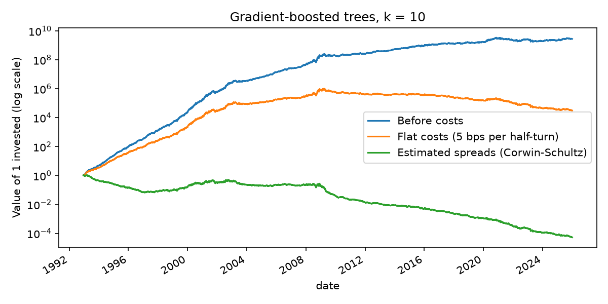
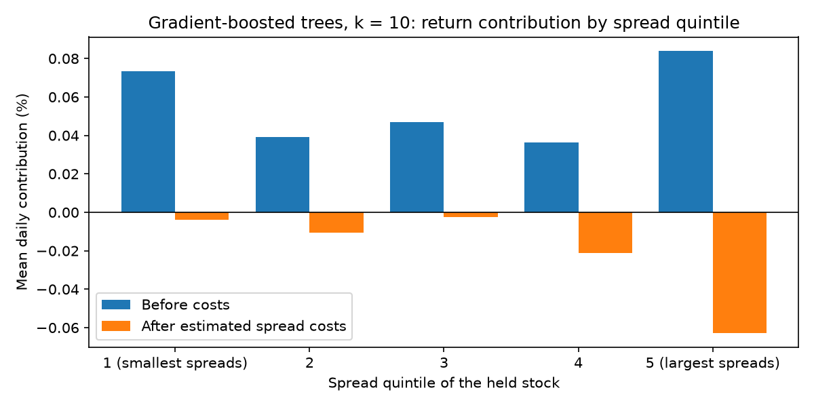
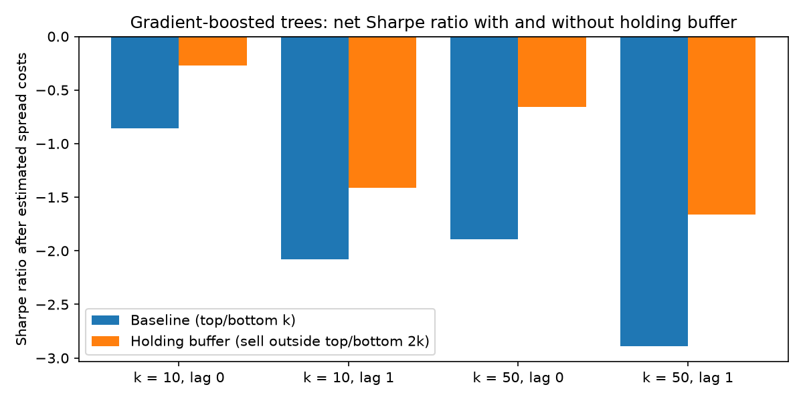

# ML Statistical Arbitrage after Trading Costs

Daily long-short portfolio of S&P 500 constituents, 1992–2025, with signals from gradient-boosted trees as in Krauss, Do and Huck (2017). Trading costs are half of a stock-specific Corwin-Schultz (2012) spread estimate per unit traded, instead of the paper's flat 5 bps per half-turn.

| strategy | gross | flat 5 bps | est. spread | turnover | break-even |
|---|---:|---:|---:|---:|---:|
| GBT, k = 10 | 0.28 | 0.14 | −0.10 | 2.74 | 20 |
| GBT, k = 10, one-day lag | 0.14 | 0.00 | −0.24 | 2.74 | 10 |
| GBT, k = 50 | 0.16 | 0.05 | −0.13 | 2.29 | 14 |
| GBT, k = 10, holding buffer | 0.27 | 0.16 | −0.03 | 2.19 | 25 |
| 1-day reversal, k = 10 | 0.09 | −0.09 | −0.48 | 3.72 | 5 |

Mean daily return in %, daily turnover (4 = full rebalance), break-even spread in bps (spread at which costs equal the gross return).



- Before costs the rebuild matches the paper: 0.38 % per day over 1992–2015 (paper: 0.37 % for the same model).
- Half the gross return disappears with a one-day execution lag, most likely bid-ask bounce in closing prices.
- After estimated spreads every specification loses money. The break-even spread is 36–63 bps until 2002 and mostly 2–12 bps since 2009.
- The model earns about three times as much as plain 1-day reversal before costs; the reversal rule stops working around 2001.



- The widest-spread quintile has the highest gross return per position and about 60 % of the net loss.
- Three quarters of the reversal rule's gross return come from that quintile.



- Holding buffer: buy from the top/bottom k, sell only outside the top/bottom 2k (fixed in advance, not tuned). Turnover −20 % (k = 10) to −33 % (k = 50), gross return −3 % to −6 %. Still negative after costs in every year since 2009.

## Method

- Features: 31 past returns (1–20 days, 40–240 days). Label: next-day return above the cross-sectional median.
- LightGBM with the paper's settings (100 trees, depth 3, learning rate 0.1), retrained every 250 days on the preceding 750 days. All results out-of-sample.
- Equal-weighted top/bottom k. Main timing as in the paper (trade at the signal's close), plus a one-day lag.
- Corwin-Schultz spreads averaged over 21 days, floored at one tick. Universe: point-in-time index members.
- Leakage test with random features: returns close to zero.

## Caveats

- One model only, on purpose: the focus is on trading costs, not on comparing forecasting methods. The paper's random forest, neural network and ensemble are still to be tested.
- Spreads are estimated, not observed, and noisy for single stocks. With a zero floor instead of a one-tick floor the model breaks even over the full sample (0.02 % per day); the difference is almost all in the 1990s.
- No market impact. One buffer size.

Details: [docs/documentation.pdf](docs/documentation.pdf).

## Data

CRSP daily data and S&P 500 membership via WRDS, 1990–2025, including delisted stocks. Data and stock-level output cannot be shared; only aggregates are in the repo.

Wharton Research Data Services (WRDS) was used in preparing this project: "ML Statistical Arbitrage after Trading Costs". This service and the data available thereon constitute valuable intellectual property and trade secrets of WRDS and/or its third-party suppliers.

## Run

```bash
pip install -r requirements.txt
pytest                                  # synthetic data, no WRDS needed
python scripts/01_build_data.py         # WRDS username in WRDS_USERNAME
python scripts/02_run_baseline.py       # --noise for the leakage test
python scripts/03_run_costs.py          # costs, quintiles, buffer
```

Parameters in `config.yaml`. Downloads and predictions are cached; `--force` recomputes.

`notebooks/one_day_by_hand.ipynb` walks through one trading day on simulated data (features, model, portfolio, turnover, Corwin-Schultz, costs, buffer) and checks each step against the pipeline. It needs no WRDS access.

## Use of AI

I designed and carried out the project myself: research question, methodology, parameters, checks and interpretation. I used Claude Code (Anthropic) as a tool to speed up the implementation and to help edit the text. All code was reviewed, tested and run by me. The assistant never had access to CRSP data.

## References

Corwin, S. A., & Schultz, P. (2012). A simple way to estimate bid-ask spreads from daily high and low prices. *Journal of Finance*, 67(2), 719–760.

Krauss, C., Do, X. A., & Huck, N. (2017). Deep neural networks, gradient-boosted trees, random forests: Statistical arbitrage on the S&P 500. *European Journal of Operational Research*, 259(2), 689–702.
